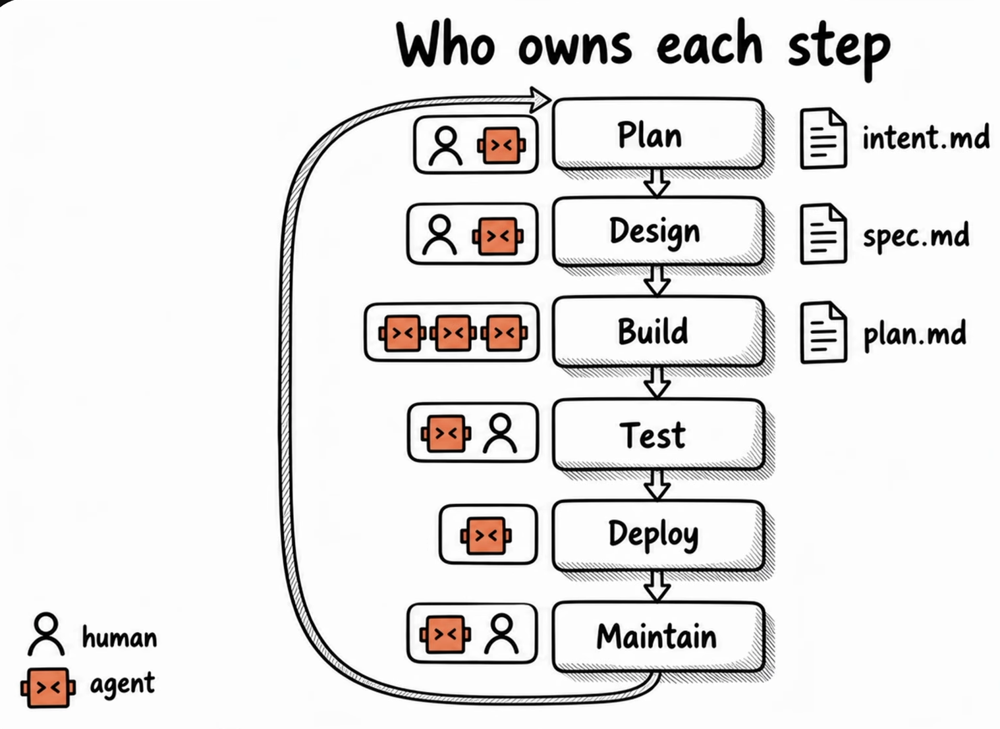

# AI-Native Software Development Life Cycle (SDLC)
This summary outlines the AI-Native SDLC playbook by Anthropic, designed to accelerate development cycles using Claude Code agents. By integrating AI into every stage, developers can drastically reduce the time spent in the traditional 'building' phase.



## Who Owns Each Step

| Step     | Owner(s)               | Artifact     |
| -------- | ---------------------- | ------------ |
| Plan     | Human + Agent          | `intent.md`  |
| Design   | Human + Agent          | `spec.md`    |
| Build    | Multiple Agents        | `plan.md`    |
| Test     | Agent + Human          |              |
| Deploy   | Agent                  |              |
| Maintain | Agent + Human          | feeds a new `intent.md` |

The artifacts form a chain: `intent.md` (the **why**) → `spec.md` (the **what**) → `plan.md` (the **how**).

## A Clear Prompt given by Anthropic to convert `intent.md` file into a proper spec

```text
Read the attached `intent.md` and produce a requirements and design spec for integrating into our existing codebase. Apply the skills available to you so the plan conforms to our brand guidelines, security policies and UX standards. Document the spec fully as `spec.md`, ready to hand to the engineering team. Describe clearly any areas of concern, especially where you cannot satisfy contradicting policies.
```

## The AI-Native Workflow

### 1. Plan
- **Goal:** Replace manual requirement gathering with AI-driven interviews.
- **Mechanism:** Use 'grooming' skills to define objectives, resulting in an `intent.md` file. This acts as a human-readable and machine-actionable single source of truth.

### 2. Design & Architecture
- **Process:** Convert the `intent.md` (the why) into a technical `spec.md` (the what).
- **Outcome:** Clearly defined technical requirements and expected system behaviors.

### 3. Build
- **Planning:** Transform the specification into a granular `plan.md` file (the how).
- **Actionability:** This document provides a step-by-step roadmap for AI agents to execute tasks in parallel or sequentially.
- **Execution:** Multiple agents implement the tasks in `plan.md`. This is the step with no human in the loop, and where most of the time savings come from.

### 4. Test & Verification
- **Methodology:** Adoption of Test-Driven Development (TDD).
- **Layers of Testing:**
  - **Unit Tests:** Using *Jest* or *Vitest*.
  - **Component Tests:** Using React Testing Library.
  - **End-to-End (E2E) Tests:** Using Playwright or Cypress.
- **Feedback Loops:** Agents must verify their work via linting, building, and testing before reporting a task as 'done'.

### 5. Deploy (CI/CD & Production)
- **Agentic Evals:** Integrate automated evaluations into CI/CD pipelines to ensure model or rule changes don't degrade performance.
- **Deployment:** Implement automated pre-deployment builds and post-deployment monitoring (e.g., *DataDog*, *Sentry*) to trigger automated rollbacks if system health metrics drop.

### 6. Maintain
- **Closing the Loop:** Periodically analyze logs and performance metrics to identify recurring issues, then feed these findings back into a new `intent.md` to initiate the next cycle.
