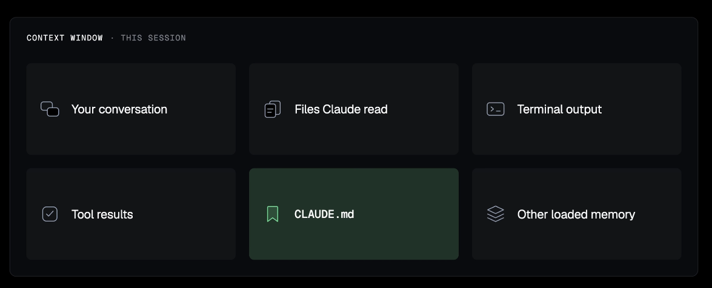

# Context-Window

In the context of working with *Claude Code*, the **context window** represents the total amount of information including your conversation history, file content, terminal outputs, and system instructions that the agent can actively process at one time.

**Key takeaways regarding the context window:**

- **Attention Budget:** You should treat the context window like a limited **attention budget**. Every line added to your `CLAUDE.md` or `agents.md` file consumes space that the agent could otherwise use for the specific task at hand.
- **Context Rot:** A critical insight shared is that model performance begins to degrade long before the maximum token limit is reached. Even with a 200,000 token limit, meaningful **degradation (context rot)** can occur as early as 50,000 tokens.
- **Strategic Management:** To maintain peak performance, you should avoid cluttering the context with unnecessary information. If you start a new, unrelated task, it is best practice to run the `clear` command to reset the context and avoid carrying over irrelevant data .
- **Monitoring Usage:** You can proactively monitor your resource usage by running the `context` command within *Claude Code*. This allows you to see how much of your budget is being spent and which files or instructions are consuming the most space.