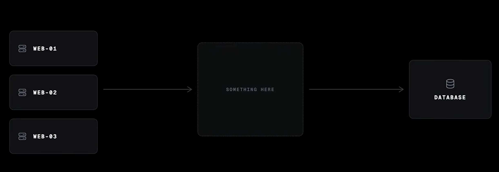
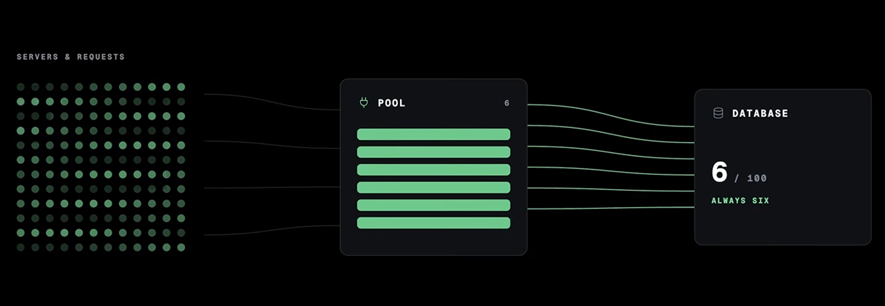
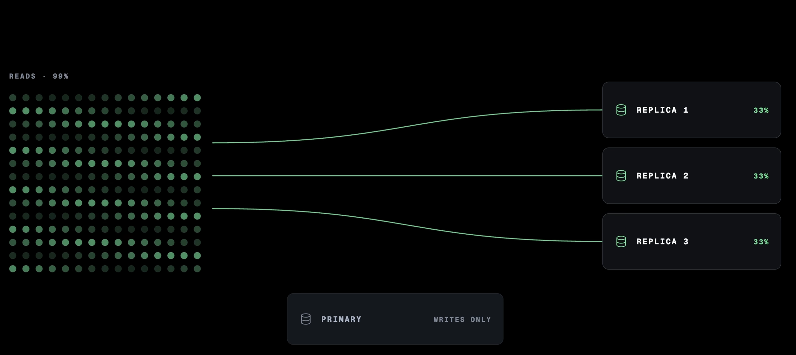
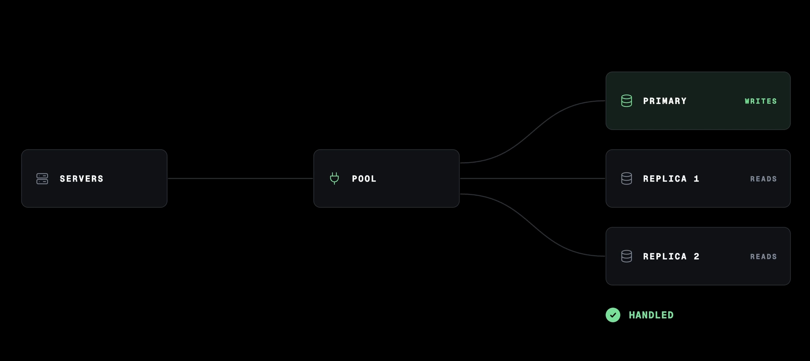

# Connection Pooling and Read Replicas

## Database Bottlenecks

- **Connection Pooling**: Databases have a hard limit on open connections.

  - E.g: A ticket app was completely fine, but a popular show went on sale, the traffic spiked, suddenly you're getting database connection errors right at the moment things were going well.

  - So the fix for this problem sits between our servers and our database.

    

- **Connection Limits**: Solved by using **Connection Pooling** (e.g., `PgBouncer`) to manage fixed sets of connections, preventing connection exhaustion during traffic spikes.

  

- **Indexing on the Database**: Let's say if our app looks users up by email on every login, there is no index on the email column, the database is scanning every row to find one person every single time. That one missing index looks exactly like a capacity problem which it is not. Thus, *add the index* and the load can just disappear.

- **Read Capacity**: Offload read-heavy traffic to **Read Replicas**. Keep the Primary database for write operations.

  - Since most applications are read-heavy most of the time, if the database is truly at capacity, the solution is to create read-only copies of our pirmary database.

  - All *writes* continue to go to the primary database, while *reads* are distributed across the read replicas.

    

  - **Strategic Reading**: For parts of the application where absolute consistency is required (e.g., seeing your own post immediately), we can choose to read directly from the **primary** instead of the **replicas**.

- **Trade-Off**: Introduces replication lag, where data may be temporarily stale.

  